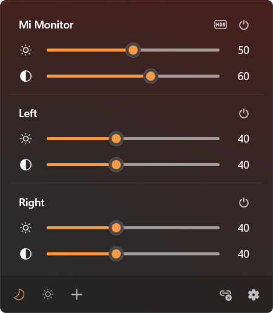
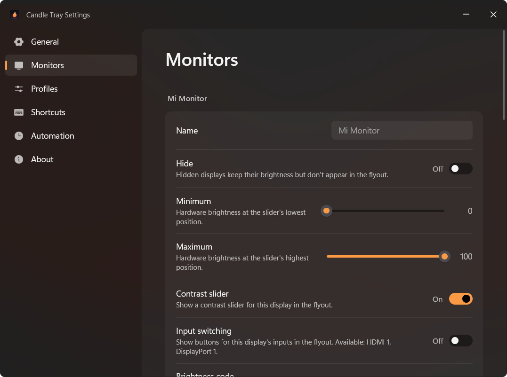
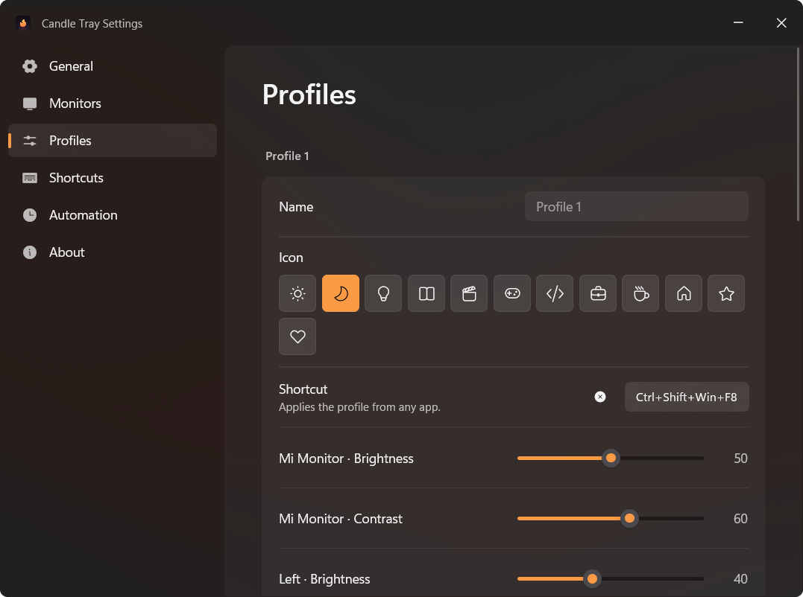
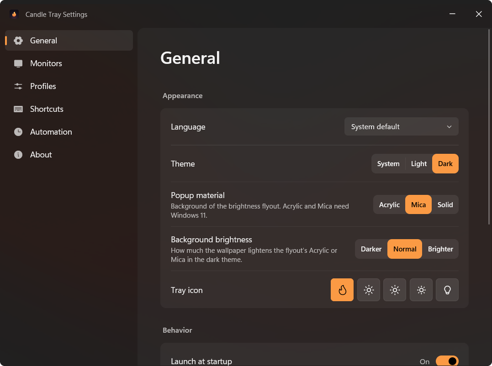
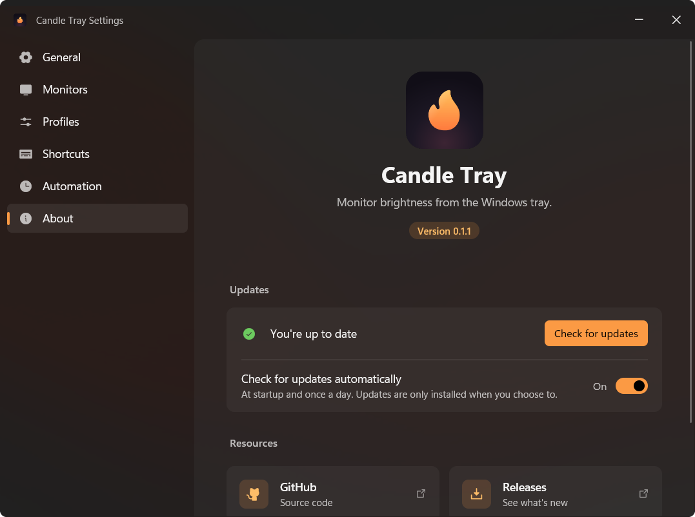

<p align="center">
  
</p>

<h1 align="center">Candle Tray</h1>

<p align="center">
  <b>Free, open-source Windows tray app for monitor brightness with DDC/CI and WMI control, HDR white level, profiles, global shortcuts, a time-of-day schedule, adaptive brightness, and in-place updates.</b>
</p>

<p align="center">
  <a href="https://github.com/vertopolkaLF/candle-tray/releases">Download</a>
  |
  <a href="https://github.com/vertopolkaLF/candle-tray/issues">Issues</a>
</p>

<p align="center">
  
  
  
  
</p>

---

## Overview

Candle Tray puts a brightness slider for every display in the Windows notification area. It is a
native Windows application written in Rust, with the tray popup and Settings both rendered by
GPUI, and a rewrite of [Twinkle Tray](https://github.com/xanderfrangos/twinkle-tray) by
Xander Frangos.

<p align="center">
  
</p>

## Features

### Every display in one popup

Click the tray icon for brightness sliders for every display: external monitors through DDC/CI
and laptop panels through WMI. Optional contrast sliders (VCP 0x12) and input source buttons
(VCP 0x60) can be turned on per display. HDR displays get an HDR toggle and an SDR white level
slider. Link levels to move every display together, or turn the displays off from the popup.
Scrolling over the tray icon changes brightness too.

### Per-display settings

Rename or hide displays, map the slider to a hardware minimum and maximum, give inputs your
own names, and set a vendor brightness VCP code for displays that need one. Every setting
applies live.

<p align="center">
  
</p>

### Profiles

Save levels for every display as a profile with its own icon and switch to it from the
popup's bottom bar or with a global shortcut. Profiles can also be applied automatically while
an app is in front, or when the computer switches between battery and mains power.

<p align="center">
  
</p>

### Automation

- A time-of-day schedule with clock times, sunrise and sunset (with location detection) and
  smooth transitions.
- Dimming after a period without input.
- Adaptive brightness from an ambient light sensor.

### Look and feel

Light, dark or system theme, Acrylic, Mica or solid popup material, and a choice of tray
glyphs. English and Russian interfaces.

<p align="center">
  
</p>

### More features

- Global shortcuts for brightness steps, profiles and turning displays off.
- Restoring levels after sleep and display reconnection.
- Command-line control for scripts (see [Command line](#command-line)).
- Twinkle Tray settings import.
- Start with Windows and update in place from GitHub Releases.

## Requirements

- Windows 10 or Windows 11 (x64, ARM64 or x86).
- External displays need DDC/CI enabled in their on-screen menu for hardware brightness.

## Install

1. Open the [latest release](https://github.com/vertopolkaLF/candle-tray/releases/latest).
2. Download the installer matching your Windows architecture (`x64`, `arm64` or `x86`) and
   run it. The installer is per-user, uses `%LOCALAPPDATA%\Programs\Candle Tray` and creates a
   Start Menu shortcut. Uninstalling preserves your settings silently.
3. Alternatively, download the matching portable ZIP, extract it, and run `candle-tray.exe`;
   no separate asset folder is required.
4. Find the icon in the notification area. If it is hidden, Windows may have tucked it under
   the `^` overflow menu.

To bring over an existing setup, use the Twinkle Tray settings import offered by the app.

## Updating

Candle Tray checks for a new release at startup and every hour (Settings → About can turn this
off). A Windows notification shows the app icon and **Install update** and **View Release**
buttons. Choose **Install update**, or **Update** in the flyout or on the About page, to
download the portable ZIP for your architecture, verify its SHA-256 and restart into the new
version. A notification confirms the successful update after relaunch. Both the installed
and the portable version update this way.

<p align="center">
  
</p>

## Command line

Use one command per invocation (values accept both `--option value` and
`--option=value`):

```text
candle-tray.exe --set 50 [--display <selector>]
candle-tray.exe --offset -10 [--display <selector>]
candle-tray.exe --contrast 70 [--display <selector>]
candle-tray.exe --profile "Night"
candle-tray.exe --off
candle-tray.exe --input HDMI1 --display <selector>
candle-tray.exe --show
```

The selector defaults to `all`: all visible displays. It can also be a 1-based
position in the popup's configured display order, an exact display ID, or a
case-insensitive substring of the display name (including a custom name).
An exact ID wins over a name match; a substring selects every matching display.
Hidden displays are excluded. Brightness and contrast values are 0–100;
offsets are signed integer percentage points, clamped to 0–100 per display.
Brightness uses the popup slider scale, including configured min/max mapping
and SDR white level while HDR is active. Contrast requires per-display opt-in.
Unavailable controls/displays are skipped and logged.

Profiles accept a case-insensitive full name or a 1-based profile number.
Duplicate names are rejected. `--off` uses the configured power-off method.
Input switching requires an explicit selector and accepts `HDMI1`, `HDMI2`,
`DP1`, `DP2`, `USB-C`, or a nonzero hexadecimal VCP 0x60 value such as `0x11`.
The display must support DDC/CI input switching; raw values are forwarded even
when absent from its advertised input list.

Twinkle Tray spellings `--MonitorNum=2`, `--MonitorID=<exact-id>`, `--All`,
`--Set=50`, and `--Offset=-10` are also accepted, with either value form.
For example: `candle-tray.exe --MonitorNum 2 --Offset -10`.

Commands are sent to the running instance using a JSON `WM_COPYDATA` payload;
they do not open the popup unless `--show` is used. A plain second launch still
opens the popup. If Candle Tray is not running, it starts normally and queues
hardware commands until the first monitor snapshot. Unknown arguments, invalid
values, conflicting commands/selectors, and forwarding failures exit nonzero.
Execution is asynchronous: successful forwarding acknowledges queueing, not
hardware completion. Selection/control failures are written to
`%APPDATA%\Candle Tray\log.txt` and do not change the sender's exit status.

## Build from source

Install Rust 1.95.0 and Visual Studio C++ Build Tools with the Windows SDK.
ARM64 packaging also needs the ARM64 C++ tools and Clang (used by dependencies).
Run these commands in PowerShell from the repository root:

```powershell
$env:CARGO_HTTP_CHECK_REVOKE = "false"
.\cargo-worktree.ps1 check --locked
.\cargo-worktree.ps1 fmt --package candle-tray --check
.\cargo-worktree.ps1 clippy --all-targets --locked '--' -D warnings
.\cargo-worktree.ps1 build --release --locked
```

The wrapper reuses the main checkout's `target/` directory in Git worktrees.
To create release packages in `dist/<version>/`:

```powershell
.\build.ps1 -Arch x64,arm64,x86
.\build.ps1 -Arch x64 -SkipInstaller
```

NSIS 3.11 is used from PATH, the standard installation directory, or `.tools/`.
If absent, the script downloads its ZIP using curl's `--ssl-no-revoke` to work
around this machine's Schannel revocation lookup failures; TLS certificate
verification remains enabled. The portable-only command does not require NSIS.
Regenerate the committed icons from `assets/app-icon.svg` offline with
`.\tools\generate-icon.ps1` once Cargo dependencies have been cached.

CI checks formatting on Ubuntu and runs Clippy and tests on Windows. Manually
run the Release workflow to build every architecture and create a draft GitHub
release with an installer and a portable ZIP for each; publication is a separate
action.

## Settings

Settings are stored in `%APPDATA%\Candle Tray\settings.toml`, including when
running the portable executable.

## License

Licensed under the [MIT License](LICENSE). See
[THIRD_PARTY_NOTICES.md](THIRD_PARTY_NOTICES.md) for acknowledgements.
